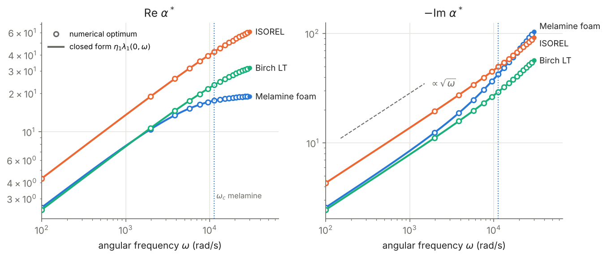
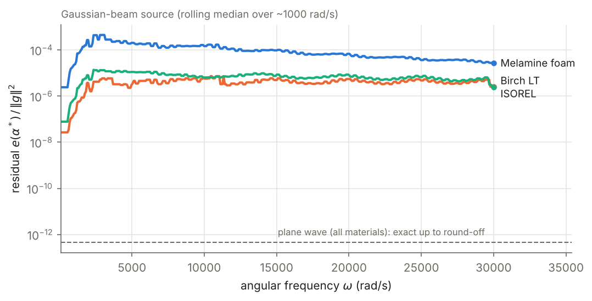
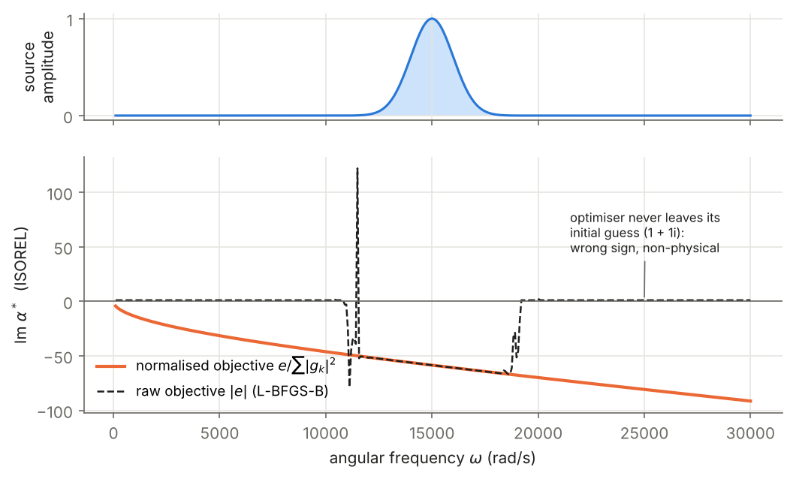

# Equivalent impedance of porous acoustic absorbers

How well can a porous wall be replaced by a single complex boundary coefficient, and what should that coefficient be?

Simulating sound in a room with absorbing walls is expensive if the wall is meshed as a second, lossy medium. A common shortcut replaces the wall with a Robin boundary condition on the air side,

$$\eta_0\,\partial_n u + \alpha(\omega)\,u = 0 ,$$

with a complex, frequency-dependent coefficient $\alpha(\omega)$. The full write-up is in [`docs/report.pdf`](docs/report.pdf). This repository computes the $\alpha$ that best reproduces the full air + porous-wall transmission problem. It does this for three materials and two source geometries, and measures how much error the reduction leaves behind.

<p align="center"></p>

## Main results

1. **For a plane wave, the reduction is exact and α has a closed form.** The numerical optimum coincides with $\alpha^*(\omega)=\eta_1\lambda_1(0,\omega)$, the characteristic impedance of the porous layer at normal incidence. They agree to a relative 1e-7, and the residual drops to about 1e-13. This is the wall's exact Dirichlet-to-Neumann symbol: for each Fourier mode $k$, $\eta_1\lambda_1(k,\omega)$ matches the wall exactly, and a plane wave contains only $k=0$.
2. **α has two regimes, separated by $\omega_c=\sigma\phi/(\rho_0\alpha_h)$.** Below $\omega_c$ (viscous regime), $\alpha^*\approx(1-i)\sqrt{a\,\eta_1\,\omega/2}$, so the real part equals minus the imaginary part, and both grow as $\sqrt{\omega}$. Above $\omega_c$ (inertial regime), $-\mathrm{Im}\,\alpha^*\approx\omega\sqrt{\xi_1\eta_1}$ grows linearly, while $\mathrm{Re}\,\alpha^*$ saturates at $\tfrac a2\sqrt{\eta_1/\xi_1}$. Melamine foam ($\omega_c\approx1.1\times10^4$ rad/s) crosses over inside the studied band. Birch LT and ISOREL ($\omega_c\approx4.9$ and $7.2\times10^4$ rad/s) stay in the viscous regime.
3. **For a spatially structured source, no single α is exact.** Different modes $k$ want different coefficients, so the optimum is a compromise weighted by the source's spatial spectrum $|g_k|^2$. A constant α is a local approximation of a nonlocal operator. For a Gaussian beam the optimum moves by at most 1.4% from the plane-wave value, and the normalised residual stays between $10^{-6}$ and $10^{-3}$. The error is ordered by the nonlocality parameter $k_\mathrm{eff}^2/|\kappa_1^2|$, so melamine, the least resistive material, is the worst represented.

<p align="center"></p>

4. **The frequency content of the source does not affect α.** The objective is quadratic in the source $g$, so any frequency envelope $g(y,\omega)=s(\omega)\,g(y)$ only rescales it. Only the spatial profile matters.

## Why the objective must be normalised

The optimal α cannot depend on the source amplitude, but a naive optimiser can. If you minimise the raw error $|e(\alpha)|$, frequencies where the source is weak push the objective below the optimiser's absolute tolerance. The optimiser then returns its initial guess, here $1+1i$. That value is non-physical, since a passive wall needs $\mathrm{Im}\,\alpha<0$. The resulting plateaus and spikes look like physical features, such as absorption concentrated near the source's centre frequency or resonances.

<p align="center"></p>

Dividing by the source energy $\sum_k|g_k|^2$ fixes this. Combined with multi-start Nelder–Mead and warm starts along the sweep, it gives smooth curves that match the closed form.

## Model

Air occupies $-L<x<0$, with the source $g(y)$ imposed at $x=-L$. The porous wall fills $x>0$, the interface Γ is at $x=0$, and the problem is periodic in $y$. The formulation follows Magoulès et al. [1]. The wall follows a rigid-frame Biot–Allard-type model:

$$\nabla\!\cdot(\eta_1\nabla u)+\omega^2\xi_1\Big(1+\tfrac{i\,a}{\xi_1\omega}\Big)u=0,\qquad \eta_1=\tfrac{\phi}{\alpha_h},\quad \xi_1=\tfrac{\phi\gamma_p}{c_0^2},\quad a=\tfrac{\sigma\phi^2\gamma_p}{c_0^2\rho_0\alpha_h}.$$

Both problems are expanded on the modes $k_n=n\pi/L$. The mismatch between the reduced (Robin) problem and the full problem is measured mode by mode in an $H^1$-type norm with weights $A=B=1$, using the closed-form modal expressions of [1], and summed:

$$e(\alpha,\omega)=\sum_{|n|\le N}e_{k_n}(\alpha,\omega),\qquad \alpha^*(\omega)=\arg\min_{\alpha\in\mathbb C}\ \frac{e(\alpha,\omega)}{\sum_k|g_k|^2}.$$

| Material      | porosity φ | resistivity σ (N·s·m⁻⁴) | tortuosity α_h | ω_c (rad/s) |
|---------------|-----------:|------------------------:|---------------:|------------:|
| Melamine foam | 0.99       | 14,000                  | 1.02           | 1.1 × 10⁴   |
| Birch LT      | 0.529      | 151,429                 | 1.37           | 4.9 × 10⁴   |
| ISOREL        | 0.70       | 142,300                 | 1.15           | 7.2 × 10⁴   |

Parameters: $L=2$ m, $N=20$ modes on each side, $\rho_0=1.2$ kg/m³, $c_0=340$ m/s, $\gamma_p=7/5$. Frequencies are angular frequencies (rad/s).

## Reproducing

```bash
pip install -r requirements.txt
python scripts/compute.py        # all sweeps -> results/sweeps.npz (about 3 min)
python scripts/make_figures.py   # figures/*.png
python -m pytest -q              # closed form, amplitude invariance, physical sign
```

```
porous_alpha/   materials.py (Biot–Allard coefficients), sources.py (spatial profiles, Fourier coefficients),
                model.py (λ0, λ1, mode errors, normalised objective, optimiser, sweep)
scripts/        compute.py, make_figures.py
tests/          test_model.py
docs/           report.pdf (technical report), report.tex
```

## Open questions

- At fine frequency resolution, the residual for structured sources has irregular fine structure in ω (see the raw data in `results/sweeps.npz`). Air-side mode cut-offs at $\omega_n=n\pi c_0/\ell$ are a natural candidate cause, but the spacing does not match them, and optimiser tolerance has not been ruled out. This needs a dedicated study.
- Extending the reduction to a frequency band, with one α for a whole range of ω, as used in liner-placement optimisation [2].
- Nonlocal boundary conditions built directly from $\eta_1\lambda_1(k,\omega)$.

## References

1. F. Magoulès, T. P. K. Nguyen, P. Omnes, A. Rozanova-Pierrat. *Optimal absorption of acoustic waves by a boundary.* SIAM J. Control Optim., 2021. [doi:10.1137/20M1327239](https://doi.org/10.1137/20M1327239)
2. F. Magoulès, M. Menoux, A. Rozanova-Pierrat. *Frequency range non-Lipschitz parametric optimization of a noise absorption.* [arXiv:2409.06292](https://arxiv.org/abs/2409.06292), 2024.
3. J.-F. Allard, N. Atalla. *Propagation of Sound in Porous Media*, 2nd ed. Wiley, 2009.
